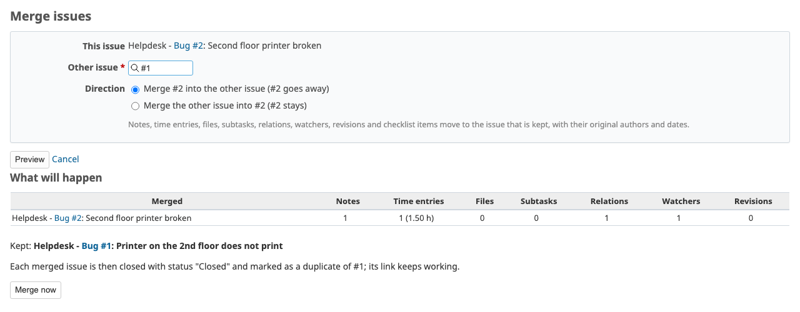
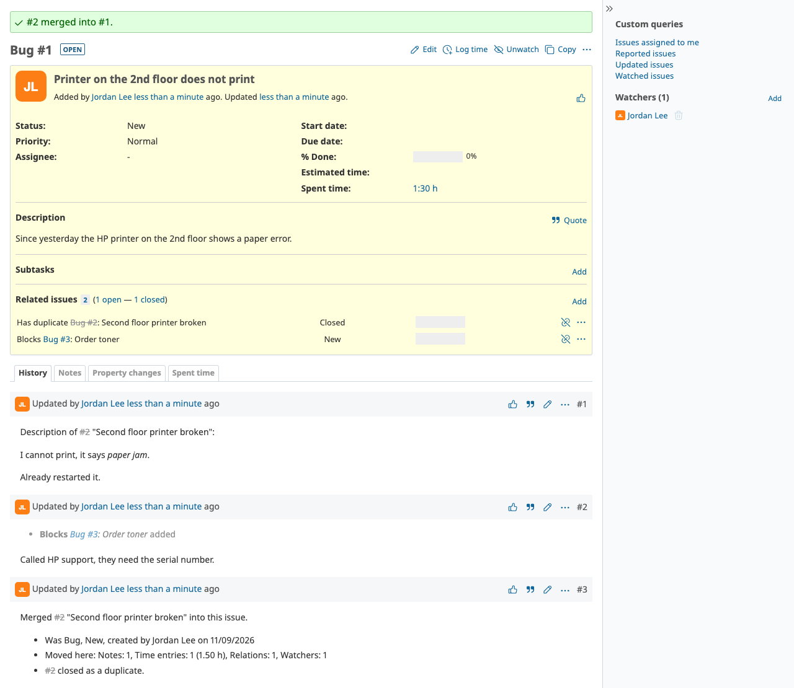

# Redmine Issue Merge

Merge duplicate issues into one without losing anything. Notes, time entries, files, subtasks, relations,
watchers, repository revisions and checklist items move to the issue you keep, with their original authors
and dates. The merged issue is closed as a duplicate (its link keeps working) or, if you prefer, deleted.



## Features

- **Preview first**: the merge screen shows how many notes, time entries, files, subtasks, relations,
  watchers and revisions will move, and lists every problem before anything is written.
- **Safe by construction**: one database transaction per merge, so a failure at any step changes nothing.
  Subtasks and relations go through the Redmine core, which keeps the issue tree consistent, refuses
  circular relations and reschedules following issues.
- **Close or delete**: by default the merged issue is closed with a configurable status and marked as a
  duplicate of the kept one. Deletion is a setting and also requires the *Delete issues* permission.
- **Nothing is lost**: the merged description becomes a note dated when it was written; the kept issue
  takes the higher priority and fills its empty custom fields; the original attributes are recorded in a
  merge note; author and assignee of the merged issue start watching the kept one.
- **Several at once**: select issues on the issue list, right-click, *Merge*, pick the one to keep.
- **Time follows the issue**: time entries are moved to the kept issue *and* its project.
- **Quiet**: one notification for the kept issue (optional), none for each moved note or subtask.
- **Protection for synced issues**: issues whose subject or description matches a regular expression can
  never be merged (useful when another system keeps them in sync and would recreate them).
- **Checklists**: items from the RedmineUP checklists plugin move too, in order.
- Translations: English, Portuguese, Brazilian Portuguese, French.



## Requirements

Redmine 6.0 or later (tested on 6.1 and 7.0), Ruby 3.2 or later.

## Install

```bash
cd /path/to/redmine/plugins
git clone https://github.com/sergioamsilva/redmine_issue_merge.git
# restart Redmine
```

No database migrations and no assets to precompile. Then:

1. *Administration → Roles and permissions*: give **Merge issues** to the roles that may merge (in the
   *Issue tracking* section). With deletion enabled, those roles also need *Delete issues*.
2. *Administration → Plugins → Redmine Issue Merge → Configure* (optional).

## Settings

| Setting | Default | |
|---|---|---|
| Merged issue | Close it as a duplicate | or *Delete it permanently* |
| Status of merged issues | first closed status | any closed status |
| Kept issue takes the higher priority | on | |
| Fill empty custom fields of the kept issue | on | restricted fields only go to a private note |
| Author and assignee of the merged issue become watchers | on | |
| Notify by email | on | one email per merge, for the kept issue |
| Never merge issues matching | empty | regular expression, case-insensitive |

## Who can merge what

A user needs **Merge issues** in the projects of every issue involved, must be able to see them, edit the
kept issue and, depending on the setting, edit (close) or delete the merged ones. A parent issue cannot be
merged into one of its subtasks; a subtask can be merged into its parent.

## For plugin authors

`Redmine::Hook` call `model_issue_merge_before_source_removal` runs inside the merge transaction, after
everything has moved and before the merged issue is closed or deleted, with `source:`, `destination:` and
`user:`. Move your own records there; raising aborts the whole merge.

The service can be used directly:

```ruby
merger = RedmineIssueMerge::Merger.new(kept_issue, [duplicate], user: User.current)
merger.valid?   # => false, merger.errors lists the reasons
merger.merge!   # raises RedmineIssueMerge::Merger::Error, nothing changed
```

## Tests

```bash
cd /path/to/redmine
bin/rails test plugins/redmine_issue_merge/test RAILS_ENV=test
```

## License

Apache License 2.0, see [LICENSE](LICENSE). Based on
[redmine_merge_issues](https://github.com/EnhydraV/redmine_merge_issues) by Vincent Vanwaelscappel; see
[NOTICE](NOTICE) and [CHANGELOG](CHANGELOG.md) for what changed.
